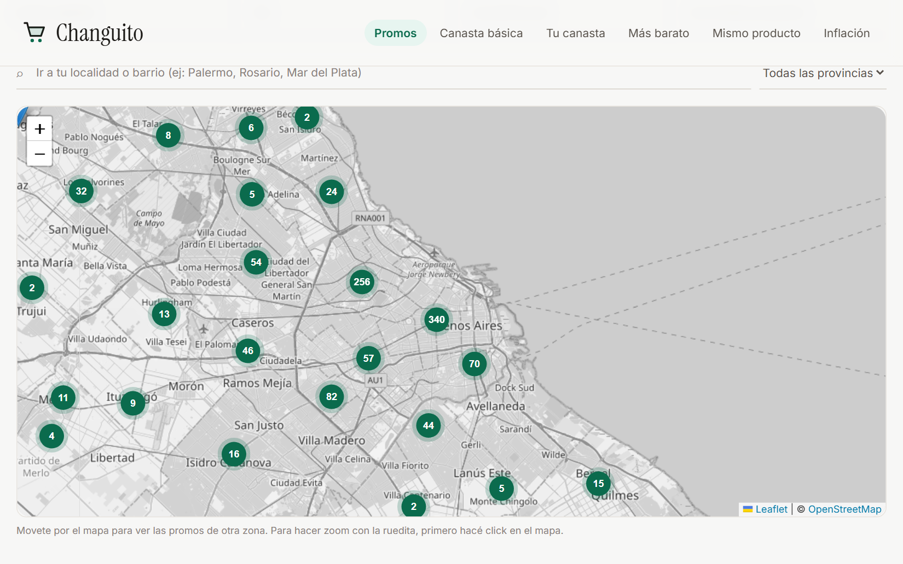
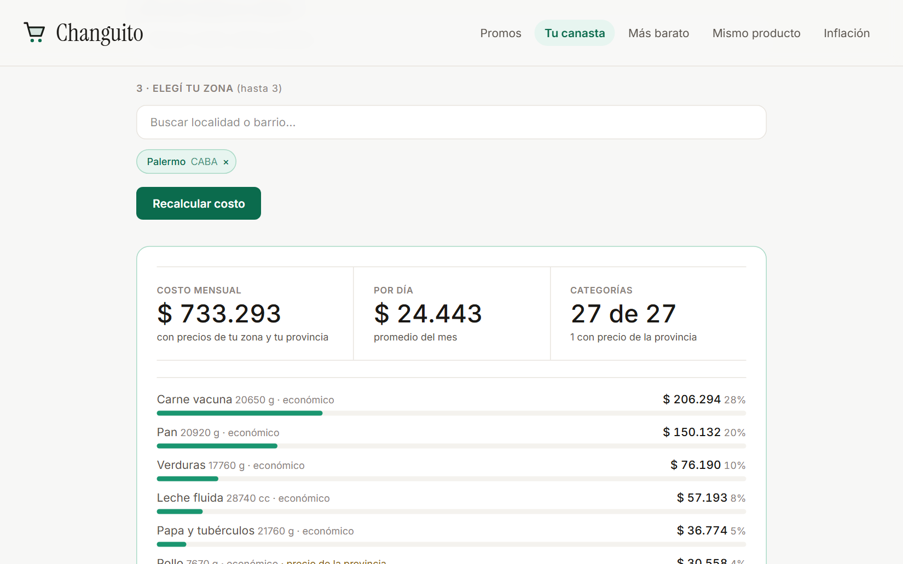
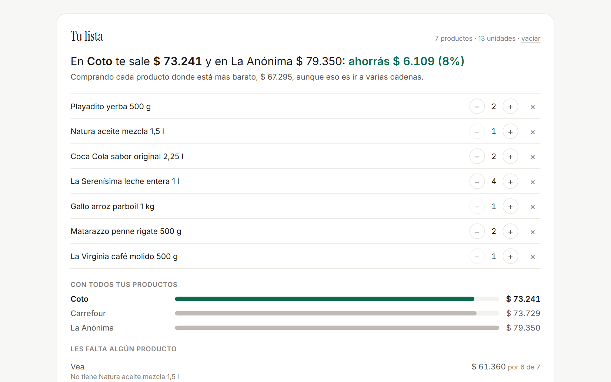
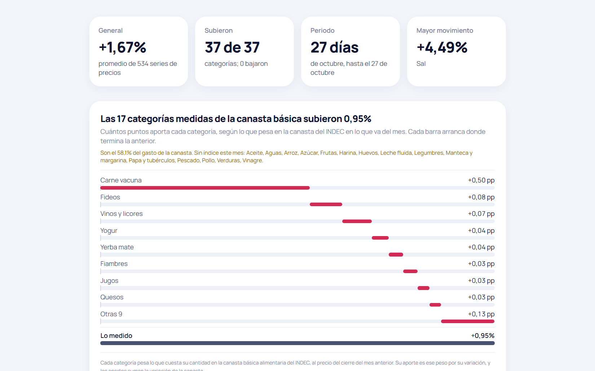

# Changuito

**Cuánto cuestan las cosas en los supermercados de la Argentina, hoy.** Las
promos en un mapa, tu compra del mes cotizada en tu zona, qué cadena es más
barata, cuánto cuesta el mismo producto en cada una y cuánto subieron los
precios, con los datos oficiales del programa SEPA de la Secretaría de
Comercio.

### [Ver el sitio →](https://precios-sepa-api-803135877045.us-central1.run.app)

[](https://precios-sepa-api-803135877045.us-central1.run.app)

| Tu canasta, cotizada | Tu lista: dónde te conviene la compra | Inflación por categoría |
|---|---|---|
| [](https://precios-sepa-api-803135877045.us-central1.run.app/canasta-personalizada) | [](https://precios-sepa-api-803135877045.us-central1.run.app/mismo-producto) | [](https://precios-sepa-api-803135877045.us-central1.run.app/inflacion) |

## En 30 segundos

- **Qué es.** Un pipeline diario que toma unos 14 millones de precios, los
  transforma con dbt sobre BigQuery y los publica en un sitio con cinco
  secciones. Corre solo todos los días.
- **Números que resisten una segunda mirada.** El dato de origen tiene trampas
  que dan un número publicado equivocado sin que nada falle. Abajo están las
  principales; el detalle de cada una, en [DECISIONES.md](docs/DECISIONES.md).
- **Calidad verificable.** 24 modelos y 104 tests de dbt, más 175 tests en
  Python y 53 en el frontend: [calidad](#calidad).
- **Costo cero, por diseño.** Todo entra en los niveles gratuitos, con una
  cuota dura que impide pasarse: [costo](#costo).

## Qué muestra

| Sección | Qué responde |
|---|---|
| **Promos vigentes** | Qué descuentos hay hoy cerca mío, sobre un mapa, con cada promo calificada según la evidencia que la respalda |
| **Tu canasta** | Describís en lenguaje natural qué consumís, una IA arma tu canasta y se cotiza con precios reales de tu zona |
| **Supermercado más barato** | Qué cadena tiene el precio más bajo, comparando productos idénticos, categoría por categoría |
| **El mismo producto** | Cuánto cuesta el mismo código de barras en cada cadena. Con **Tu lista** sumás lo que comprás siempre y te dice dónde sale más barata la compra entera. Y cuánto conviene comparar en cada categoría, y por qué |
| **Inflación** | Cuánto subió la canasta básica en el mes y cuántos puntos aporta cada categoría, más el ranking de todas las categorías con apertura por cadena |

## Arquitectura

```
Portal SEPA ──> Ingesta local ──> BigQuery ──> dbt ──────> FastAPI + React
 (datos.gob)     (Python)          (crudo)    (24 modelos)   (Cloud Run)
                     │                ▲
                     └── dispara ─────┘
                         GitHub Actions (y un cron de respaldo)
```

La descarga corre en una máquina de casa porque el portal de SEPA bloquea las IP
de datacenter (se verificó contra GitHub Actions y Colab). Cuando la ingesta
carga una fecha nueva, dispara la transformación en GitHub Actions. Si un día no
hay datos, el pipeline no corre; si faltan tres días seguidos, falla y avisa por
mail. Más detalle en [ingesta y orquestación](docs/DECISIONES.md#ingesta-y-orquestación).

## Las decisiones que importan

**Una cadena entera puede informar mal un precio.** FANTA Zero 1,75 L figuraba a
$309 en una cadena con 31 sucursales, cuando las otras diez la cobraban unos
$5.000. "El mismo producto" lo titulaba como 1.579% de diferencia, y de los 12
destacados de ese día, los 12 eran errores de la fuente. Los controles miraban
la coherencia de cada cadena consigo misma, justo lo que este error no rompe.
Ahora cada precio se contrasta contra la mediana entre empresas. Revisando el
resto del sitio apareció la regla general: lo que agrega resiste los errores de
la fuente; lo que titula con un extremo, no.

**La inflación daba 0,00%.** Restar el precio mediano de dos fechas mezclaba
cambios de precio con cambios de surtido: "Bazar y hogar" en Disco subía 75%
sin que ningún precio se moviera. Se pasó a un índice encadenado sobre los
productos presentes en ambas fechas. El primer estimador, la mediana, daba
0,00% en 563 de 564 series, porque el 97,9% de los productos no cambia de un
día al otro. Con la media geométrica (Jevons) son 201 series con variación real.
Y el índice no medía los básicos: exigía 20 productos de la gama económica por
cadena, y azúcar, aceite o leche tienen pocos. Ahora usa todas las gamas, pide
10 productos y se publica por mes; la canasta pasó de 24 a 32 categorías con
índice, y un test avisa si vuelve a bajar.

**Se perdieron datos con el pipeline en verde.** La ingesta dejó de correr cinco
días y el test que debía avisar comparaba los históricos contra los marts, que
tampoco avanzaban. El backfill decía "Cargadas" mientras BigQuery expiraba esas
fechas en menos de un minuto. Ahora el atraso se mide contra el calendario y la
ingesta verifica que lo que cargó siga existiendo.

**Un maple de huevos contaba como un huevo.** Muchas cadenas informan el paquete
entero como "1 unidad": el huevo premium costaba $2.250, y en la canasta la
línea de toallitas sumaba unos $250.000. La cantidad se lee de la descripción ("X 30 UNI", "MAPLE") y lo
que no dice cuántas piezas trae no tiene precio por pieza: no se inventa.

**La IA interpreta, el código cuenta.** Tu canasta le pedía a Gemini que armara
la canasta ajustando la del INDEC, y fallaba distinto en cada corrida. Ahora el
modelo sólo devuelve lo que depende del texto (cuántas personas, qué no
consumen, qué sube o baja) y la canasta la arma el código, con un test contra la
tabla del INDEC.

Hay nueve casos más del mismo tipo (comparar cosas que no son comparables) y
también la historia de una sección que se retiró porque el dato no podía
responder lo que prometía: [DECISIONES.md](docs/DECISIONES.md).

## Calidad

- **dbt:** 96 tests (genéricos y singulares) que corren después de cada
  transformación, más 8 tests unitarios con filas de prueba. Los singulares
  cubren lo que sólo se ve en el resultado agregado: que la carne no mezcle
  otras carnes, que la gama económica no salga más cara que la media, que el
  crudo no se atrase respecto del calendario.
- **Python:** 175 tests sobre la API y la ingesta, sin BigQuery.
- **Frontend:** 53 tests (Vitest). Se validaron metiendo 20 errores a propósito
  en el código: cada uno hizo fallar al menos un test.
- **CI:** todo lo que no necesita BigQuery corre en cada push.
- **Auditoría con agentes:** `/auditar` en Claude Code lanza tres auditores en
  paralelo (datos, coherencia entre secciones, frontend) y un cuarto que
  intenta refutar cada hallazgo grave antes del informe. Comparten un
  [protocolo](.claude/auditoria/protocolo.md): sólo cuenta lo que tiene
  evidencia, y ninguna consulta a BigQuery corre sin dry run ni tope de bytes.

## Costo

Todo corre dentro del nivel gratuito de BigQuery.

| | Uso | Límite gratuito |
|---|---|---|
| Procesamiento | ~11 GiB/día (~340 GiB/mes) | 1 TiB/mes |
| Almacenamiento | 6,9 GB | 10 GB |

Las decisiones que lo hacen posible: el crudo se carga con load jobs y las
particiones se copian con copy jobs, que no consumen cuota. Los marts recalculan
sólo las fechas que faltan, y los buscadores filtran en el navegador en vez de
consultar la base. Una cuota dura a nivel proyecto garantiza que nada genere un
cargo. Cada ahorro, medido: [costo](docs/DECISIONES.md#costo).

## Correrlo

Ver [DEPLOY.md](DEPLOY.md) para el despliegue. Para desarrollo:

```bash
# API (lee BigQuery: necesita credenciales, ver DEPLOY.md)
cd api && python -m uvicorn main:app --port 8000

# Frontend
cd frontend && npm run dev

# Tests
cd frontend && npm test
cd api && SIN_BIGQUERY=1 python -m unittest discover -p "test_*.py"
```

Las transformaciones (`dbt run` y después `dbt test`) leen BigQuery y consumen
cuota: corren en el pipeline, no hace falta correrlas a mano.

## Limitaciones conocidas

- **La cobertura fuera de CABA es más fina.** CABA tiene 71 barrios con 13,2
  sucursales promedio; el resto del país, 459 localidades con 3,4. Cuando una
  categoría no tiene precio local se usa la mediana provincial, y el sitio lo
  marca.
- **La clasificación la hace un modelo de lenguaje** y falla donde hace falta
  conocer la marca: "Bondiola LÁBRATTO PZA", un fiambre, cae en Cerdo. Un test
  vigila que Carne vacuna y Pollo no tengan más de 2% de productos ajenos.
- **Algunas cadenas tienen precios sistemáticamente fuera de mercado en una
  categoría** (Dia en Gaseosas, por ejemplo), replicados en cientos de
  sucursales. Parece un error del maestro de precios de la cadena; se documenta
  en vez de presentarlo como dato confiable.
- **El histórico es corto.** Arranca el 7 de septiembre de 2026: son semanas, no
  meses, así que las variaciones todavía no representan inflación mensual.

## Stack

BigQuery · dbt · Python (FastAPI) · React + TypeScript + Tailwind · Leaflet ·
Gemini · Docker · Cloud Run · GitHub Actions
